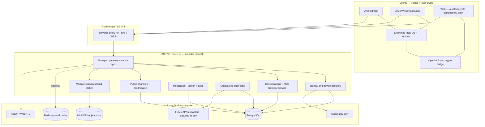

# Архитектура: безопасность, доставка, хранение, масштабирование

## 1. Логическая диаграмма (Mermaid)

## 2. Модули backend (начать с modular monolith)

**Identity** — регистрация, Argon2id, verified email, device records, refresh rotation, RBAC, sessions. Сервер подписывает credential binding только после аутентифицированного device-registration workflow. Вводить аудит замены/добавления ключей.

**Delivery / Sync** — идемпотентная публикация шифротекста, durable sequence, cursors, fetch, ACKs, fanout на устройства, уведомления. Message body — строго opaque blob.

**MLS Directory + Key Packages** — проверенные и привязанные к устройству KeyPackages, одноразовое выделение для приглашения, expire/rotate; Delivery Service не имеет секретов членов групп. MLS proposal/commit/welcome доставляются с требованиями порядка эпох.

**Public Spaces** — читабельные на сервере посты, feed, подписки, full-text search, moderation actions, CDN.

**Media** — upload sessions, manifest, checksums, quotas, signed short-lived URLs; для private assets сервер видит ciphertext и размер, не ключ. Публичные media: content checks, thumbnails/transcodes в отдельно изолированном worker.

**Trust & Safety** — жалобы, ограничения, антиспам, безопасные апелляции и audit records.

**Admin** — обязательный MFA, отдельная admin origin в production, RBAC; никакого `/admin/decrypt`.

**Calls** — 1:1 signaling via gateway, TURN config, WebRTC peers; SFU/group calls не часть исходных security promises.

**Operations** — metrics, log redaction, health, migrations, backfill, backup drills.

## 3. Архитектура на высокую нагрузку (не строить заранее)

На старте 1 backend-приложение/несколько instances, stateless gateways; PostgreSQL authoritative. Для live fanout использовать PG outbox + worker; Redis только presence/необязательный cache. Не нужно NATS/Kafka/Kubernetes на MVP. При доказанных узких местах можно выделять connection gateway и delivery workers, затем добавить брокер.

**Семантика доставки при нескольких инстансах:** делегировать durable storage и уникальную idempotency БД; пользователь может быть подключён к произвольному gateway, события relay через durable outbox и лёгкую межнодовую подписку. Потеря ephemeral event не ведёт к потере данных: pull-синхронизация по курсору обязательна.

## 4. Хранилища

- PostgreSQL: user/device/credential bindings, chats memberships, immutable message envelope history, per-device cursors, delivery receipts, key package allocation, uploaded media manifest, moderation, audit, outbox, public posts.
- S3/MinIO: media chunks and completed ciphertext; versioned object key by opaque ID; TTL для abandoned uploads; application-level integrity.
- Redis: cache, throttling buckets, ephemeral presence. При отказе Redis сообщения не пропадают.
- Локальная client DB: SQLCipher/эквивалент, защищённые хранилища платформы для KEK, durable outbox/inbox, MLS state и cursors. На web модель ключей отдельная, без обещаний hardware-backed защиты.

## 5. Потоки

### Личное текстовое сообщение
1. Sender device локально создаёт ID и гарантирует durable local outbox.
2. Реальный OpenMLS encrypt создаёт ciphertext, в котором зафиксирован уникальный application message ID/метаданные защиты от повторов.
3. Gateway проверяет auth, membership snapshot, limits, size, frame version; не расшифровывает ciphertext.
4. PostgreSQL INSERT в messages + outbox в одной транзакции, unique(sender_device_id, client_message_id), возвращает тот же durable server sequence при повторе.
5. Доставка адресатам через online push или fetch; получатель расшифровывает, коммитит local DB, подтверждает device receipt.
6. Если sender пропустил ACK — повторяет тот же ciphertext/id, сервер возвращает существующую запись. Никаких двух сообщений в UI.

### Закрытая группа MLS
Участники/устройства — листья MLS. Identity/AS связывает credentials с устройствами, DS даёт KeyPackages и пересылает MLS handshake/application messages. Коммиты эпох сериализуются по группе; отклонённый/конфликтующий commit требует client rebase/retry и восстановления группы. Сервер не создаёт скрытого участника для администратора. Сложность при плохой сети должна быть проверена отдельными интеграционными тестами.

### Публичный пост
Client отправляет cleartext по TLS с выбранным public scope. Server валидирует и хранит пост, search index, moderation. Media public stored/transcoded as public media. UI ясно показывает публичность.

### E2EE вложение
Client локально сжимает/транскодирует, шифрует chunks стандартным AEAD с уникальными nonce/derivation, computes ciphertext checksum, загружает в S3 multipart. Manifest с ключом, размером plaintext и chunk metadata идёт внутри MLS ciphertext. Server не имеет decryption key; magic bytes/MIME проверить на сервере нельзя, поэтому ограничения размера и безопасная обработка — на стороне клиента.

### 1:1 звонок
Signaling authenticated via gateway. WebRTC peer connections с DTLS-SRTP; TURN relay нельзя смешивать с корпоративным «доступом к содержимому». Устройство должно проверять, что звонит ожидаемому собеседнику (binding signaling to identity) и защищать signaling от подмены. Для доверия E2EE звонков нужна отдельная проверка end-to-end identity binding/без SFU; не использовать слово «проверено» без тестов.

## 6. Разделение прав и границы доверия

Границы: client trusted endpoint vs potentially compromised transport / edge / DB / DS / operators. E2EE сохраняет конфиденциальность контента при компрометации сервера **при условии** корректных ключей и неповреждённых клиентов; metadata (IP, чат membership, время, размеры) остаётся серверу частично доступна. Админ может блокировать аккаунт и удалять ciphertext с сервера, но не извлекать plaintext приватных чатов.

## 7. Безопасность эксплуатации

- Все внешние соединения через TLS; внутренние по закрытой сети и с аутентификацией, секреты из secrets store/env, не из Git.
- Readiness зависит от DB, не Redis; graceful shutdown, drain connections, клиентский resume.
- Бэкапы DB+objects с согласованным snapshot/manifest; recovery drill и RPO/RTO как цели, не маркетинговое обещание.
- Retention: явные TTL для токенов, исчезающих медиа, резервных копий; policy логов без личного контента.

## 8. Наблюдаемость и SLO до production

SLI: durable_ack_latency (client measured), device_delivery_latency (from server commit to receipt), reconnection_duration, sync_gap_recovery, duplicate_ui_count, media_resume_success, crypto_fail_count, outbox_depth, percent message failures by network profile.

Пример предварительных **тестовых** целей (не production SLA): 0 логических дублей и потерь в стандартном deterministic 2G test suite; 95% небольших сообщений быстрее 15 сек на GPRS baseline с уже активной сессией и живым сервером, при 20 Кбит/с/RTT 1.5 сек/3% packet loss. На более тяжёлом профиле цель — eventual delivery после восстановления сети без заявленного фиксированного срока.
