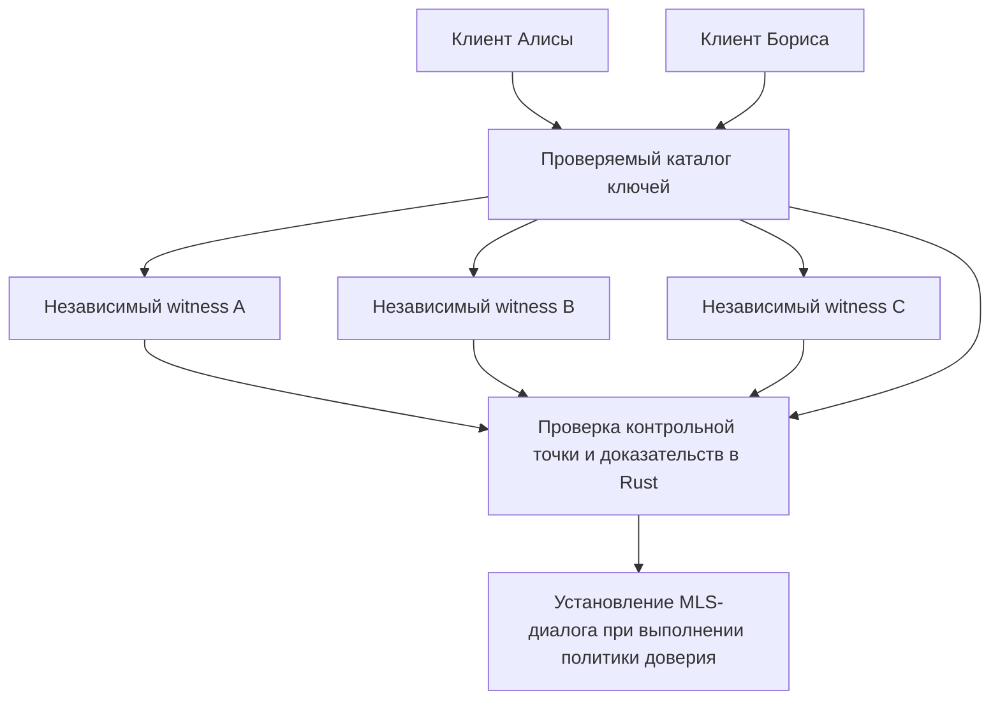
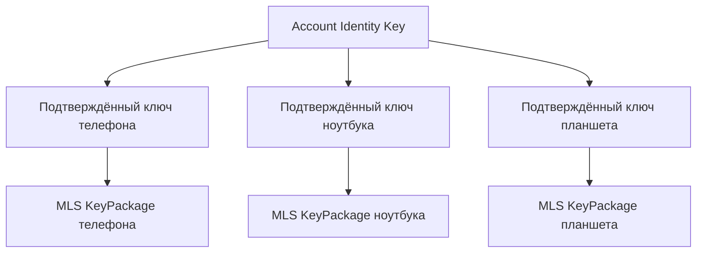

# SecureMesh — автоматическая проверка ключей собеседников

**Дата:** 27.11.2026  
**Статус:** архитектурное предложение (RFC), не реализованная функция и не подтверждение безопасности.  
**Цель:** убрать обязательную ручную сверку ключей из повседневного UX SecureMesh, сохранив защиту от подмены ключей и устойчивость к слабой сети.

## 1. Проблема

Существующий подход SecureMesh основан на независимой сверке публичных ключей устройств и их локальном закреплении (pinning). Он позволяет обнаруживать подмену при корректной ручной проверке, но создаёт неудобство: пользователь вынужден сравнивать отпечатки или QR-коды перед началом переписки.

Просто убрать проверку нельзя. Если клиент принимает любой ключ, возвращённый сервером, злонамеренный оператор может подменить ключ при первом контакте. TLS защищает соединение с сервером, но не доказывает принадлежность ключа нужному собеседнику. MLS также не решает задачу привязки ключа к пользовательской идентичности самостоятельно.

Требуется автоматическая проверка криптографической идентичности, не основанная исключительно на доверии к оператору SecureMesh.

## 2. Предлагаемое решение

Использовать **Key Transparency (KT)**: криптографически проверяемый каталог идентичностей и устройств с историей изменений, доказательствами актуальности записей и независимым наблюдением за согласованностью каталога.

Компоненты:

| Компонент | Назначение |
| --- | --- |
| OpenMLS | Шифрование личной переписки и управление эпохами MLS |
| Account Identity Key | Долгоживущая криптографическая идентичность аккаунта |
| Device Credentials | Подписанные полномочия отдельных устройств |
| Auditable Key Directory (AKD) | Проверяемый каталог ключей и версий записей |
| Независимые аудиторы / witnesses | Проверка согласованности истории и контрольных точек |
| SQLCipher | Локальное хранение закреплённых идентичностей, доказательств, контрольных точек и состояния MLS |
| Flutter | Прозрачный для пользователя UX и предупреждения при аномалиях |

Кандидат библиотеки для исследования — [Meta AKD](https://github.com/meta/akd), написанная на Rust. Использовать существующие проверенные механизмы вместо создания собственного Merkle-протокола и криптографических примитивов. Перед выбором проверить актуальную спецификацию, API, сопровождение, лицензию, аудит, размеры доказательств и совместимость зависимостей с OpenMLS и целевыми платформами.



Схема концептуальная: подписи witnesses не заменяют локальную проверку конкретной записи, её авторизации и согласованности с ранее сохранённой историей.

## 3. Модель угроз и границы гарантий

Рассматривать следующие случаи:

- сервер доставки или каталог контролируется противником;
- каталог подменяет публичный ключ или незаметно добавляет устройство;
- каталог показывает разным клиентам несовместимые версии истории (split view / equivocation);
- клиенту выдаётся устаревшая запись или контрольная точка (rollback / freeze);
- украден токен аккаунта, но не его криптографическая идентичность;
- часть независимых аудиторов скомпрометирована или недоступна;
- клиент работает офлайн либо на медленном соединении;
- пользователь меняет устройство, восстанавливает аккаунт или теряет все локальные ключи.

Key Transparency не устанавливает личность физического человека при первом контакте. Если все источники информации контролируются одним противником, криптография не может сама по себе определить, кому принадлежит username. Согласованный каталог может содержать изначально ложную запись, поэтому нужны авторизация изменений, самостоятельная проверка собственного аккаунта и независимое наблюдение; для особо чувствительных контактов сохраняется независимая ручная сверка.

Не обещать защиту от заражённого устройства, вредоносного обновления клиента, раскрытия уже полученной переписки собеседником или отказа сервера в обслуживании. KT не является механизмом сокрытия всех метаданных и не заменяет аудит OpenMLS, локального хранилища и инфраструктуры.

## 4. Идентичность аккаунта и устройства

Перейти от доверия исключительно к ключу отдельного устройства к проверяемой долговременной идентичности аккаунта. При этом сохранить отдельные ключи устройств и MLS KeyPackage.



Концептуальная модель записи:

```rust
struct AccountIdentity {
    account_id: Uuid,
    identity_public_key: PublicKey,
    identity_version: u64,
    device_roster_hash: Hash,
}
```

Это иллюстрация структуры, а не готовый API AKD или точный формат сериализации.

Основные инварианты:

- Сервер не получает закрытый ключ идентичности аккаунта и не может самостоятельно подписать полномочия нового устройства.
- Клиент проверяет криптографическую авторизацию добавления, отзыва и ротации устройств, а не только состояние серверной сессии.
- Подписи должны связывать аккаунт, устройство, ключ, назначение, версию и контекст протокола; повтор старой авторизации не должен возвращать отозванное устройство.
- Необходимо проверять связь MLS KeyPackage с авторизованным ключом конкретного устройства, а не только наличие валидной подписи KeyPackage.
- Каталог должен удостоверять привязку username к стабильному `AccountId`, включая переименование и повторное выделение имени. Нельзя автоматически считать новый аккаунт с прежним username тем же человеком.
- Хеш списка устройств должен быть связан с каноническим представлением подписанного списка, содержащего необходимые сведения об актуальных и отозванных устройствах.

Хранение и восстановление корневого ключа — отдельный проектный вопрос. Рассмотреть защищённое хранилище, подтверждение доверенным устройством, отдельный recovery secret или делегированные/пороговые полномочия. Не выдавать восстановление доступа по почте или паролю за восстановление криптографической идентичности. Потеря всех доверенных ключей требует явной политики сброса идентичности; она не должна скрывать смену ключей от собеседников.

## 5. Проверяемый каталог и независимые наблюдатели

Каталог должен предоставлять клиенту достаточные доказательства для проверки следующих свойств:

1. Запрошенное имя соответствует нужному аккаунту.
2. Возвращённая идентичность и версия присутствуют в подтверждённом состоянии каталога.
3. Список устройств соответствует этой идентичности и изменения авторизованы.
4. Новая контрольная точка согласована с ранее принятой историей.
5. Контрольная точка достаточно актуальна согласно явно заданной политике.

Использовать механизмы доказательств, истории и аудита выбранного KT-протокола. Не считать простой подписанный JSON или Merkle inclusion proof достаточными для защиты от split view и rollback.

### 5.1. Аудиторы и witnesses

Начальный вариант для исследования — три независимых участника с политикой подтверждения 2 из 3. Это **не готовая безопасная пороговая схема**: два кворума по два участника могут пересекаться только в одном участнике, и если он злонамерен, возможно подтверждение конфликтующих состояний. Поэтому до утверждения порога необходимо явно задать допустимое число скомпрометированных сторон и доказать свойства согласованности, а не просто подсчитать подписи.

Например, при модели с одним византийским участником можно исследовать 3 из 4 с независимым состоянием и запретом подписывать несовместимые истории; это даёт пересечение двух кворумов как минимум в двух участниках. Такая арифметика сама по себе не доказывает корректность полного протокола. Альтернативный вариант 3 из 3 снижает доступность. Окончательный выбор — после моделирования отказов, проверки выбранного KT-протокола и анализа стоимости.

Требования к наблюдению:

- Каждый witness проверяет последовательность и допустимые переходы истории относительно собственного устойчиво сохранённого состояния.
- Подписи относятся к одной и той же контрольной точке, версии/эпохе, идентичности каталога и формату протокола.
- Наблюдатели сравнивают контрольные точки по независимым каналам; конфликтующие подписанные состояния сохраняются как доказательство инцидента.
- Ключи witnesses и политика их обновления заранее известны клиенту и защищены от односторонней незаметной замены оператором каталога.
- Независимость подразумевает разные административные полномочия. Три VPS с одним владельцем, общей панелью управления и одинаковым доступом не защищают от этого владельца.
- Пользователи проверяют собственную запись, чтобы обнаруживать несанкционированное добавление устройства или изменение идентичности; определить допустимую задержку обнаружения.

### 5.2. Приватность каталога

Не публиковать открытый перечень usernames, email, устройств и их связей. Использовать предусмотренные протоколом механизмы приватного индексирования (например, VRF, если поддерживается выбранной схемой). Учитывать перебор имён, наблюдение запросов, доступ аудиторов к данным и корреляцию времени запросов. KT не должен создавать новый общедоступный источник метаданных пользователей.

## 6. Алгоритм автоматической проверки

### Первый контакт

1. Клиент разрешает username в стабильный AccountId и запрашивает запись, доказательства и контрольную точку.
2. Rust-ядро проверяет доверенные подписи контрольной точки и политику независимого подтверждения.
3. Проверяет доказательство соответствия имени, идентичности и актуального списка устройств.
4. Проверяет согласованность истории с локально сохранённой контрольной точкой, если она существует.
5. Проверяет полномочия устройств и связь их MLS KeyPackage с подтверждёнными ключами.
6. Атомарно сохраняет проверенную идентичность, версию и контрольную точку в SQLCipher.
7. Только после этого разрешает создание MLS-диалога и передачу первого приватного сообщения.

Если проверка не проходит, клиент не должен незаметно переключаться на TOFU или принимать ключ по одному серверному ответу.

### Повторный контакт

Использовать сохранённую идентичность и MLS-состояние. При необходимости обновить доказательства асинхронно. Не обращаться ко всем witnesses синхронно для каждого сообщения.

### Добавление устройства и изменение ключа

Проверить авторизованное изменение каталога и полномочия нового устройства, после чего провести необходимые операции MLS Add/Welcome или Remove/Commit. Изменение каталога не означает автоматическое обновление состава всех MLS-групп и не даёт устройству право на старую историю.

Неожиданная смена корневой идентичности требует отдельного безопасного сценария: остановить принятие новой идентичности, уведомить пользователя и запросить повторную проверку. Не подменять ранее вручную закреплённый ключ автоматически при миграции.

## 7. Пользовательский интерфейс

Обычный сценарий: пользователь ищет собеседника по username, принимает приглашение (если предусмотрено продуктом) и начинает переписку; проверка ключей выполняется автоматически.

| Событие | Поведение |
| --- | --- |
| Первый контакт | Автоматическая проверка идентичности и доказательств |
| Повторный контакт | Использование подтверждённой локальной идентичности |
| Добавление авторизованного устройства | Автоматическая проверка полномочий, затем штатная операция MLS |
| Обычная ротация ключей MLS | Автоматическая обработка, без ручной сверки каждой эпохи |
| Неожиданная смена идентичности | Предупреждение и запрет незаметного перехода на новый ключ |
| Несогласованные доказательства | Блокировка принятия нового ключа |
| Временно недоступный каталог | Сохранение очереди, работа уже установленных диалогов в рамках политики актуальности |
| Повышенные требования к безопасности | Необязательная независимая сверка QR/отпечатка |

Предлагаемые состояния интерфейса: «Проверено автоматически», «Ожидается проверка», «Ключ изменился», «Проверено вручную», «Не удалось проверить». Не обозначать автоматически подтверждённую запись как удостоверенную личность физического человека. Не показывать ложный зелёный статус при отсутствии доказательств.

## 8. Слабые сети и офлайн-режим

Key Transparency не должен уничтожить главное преимущество SecureMesh — надёжную доставку при нестабильной связи.

- Кешировать проверенные записи, версии, контрольные точки и необходимые доказательства в SQLCipher.
- Запрашивать доказательства при первом контакте, значимом изменении идентичности/состава устройств и истечении срока актуальности, а не при каждой отправке.
- Получать компактные контрольные точки, батчить запросы, обновлять кеш асинхронно, избегать повторной передачи одинаковых доказательств.
- Сохранить возможность создания локального черновика и долговечной очереди. Не формировать и не отправлять MLS-конверт на неподтверждённый новый ключ.
- Для уже установленных диалогов предусмотреть явно ограниченную политику работы при временной недоступности каталога. Не допускать незаметного отката на более старый roster; учитывать риск задержанного отзыва устройства.
- Определить максимальный срок устаревания, реакцию на известный отзыв, поведение при неверных часах и восстановлении приложения из старого бэкапа. Эти параметры пока не утверждены.
- Проверять накладные расходы в байтах, RTT, задержке первого контакта и энергопотреблении в существующих GPRS/severe-профилях. Сохранять исторический приёмочный предел P95 GPRS ≤ 15 секунд для установленного текстового диалога; отдельную цель для первого контакта установить после измерений.

## 9. Интеграция в кодовую базу

Предлагаемые точки расширения (имена предварительные):

```text
SecureMesh/
├── src/
│   ├── SecureMesh.Api/
│   │   └── KeyTransparency/
│   ├── crypto_core/
│   │   └── src/
│   │       ├── account_identity.rs
│   │       ├── key_transparency.rs
│   │       └── device_credentials.rs
│   ├── key_directory/          # интеграция выбранного KT/AKD
│   └── key_auditor/            # независимый наблюдатель
├── apps/client_flutter/lib/    # UX и вызовы Rust-ядра
├── contracts/
│   └── key_transparency.proto
└── tests/
    └── key_transparency/
```

OpenMLS остаётся механизмом E2EE. KT дополняет его проверяемой службой аутентификации. Вся критичная проверка доказательств и разрешение криптографических операций должны находиться в Rust-ядре, а не зависеть от того, как Flutter отрисовал интерфейс. Не вводить небезопасные обходы для старых клиентов.

## 10. Альтернативы

| Подход | UX | Защита от подмены ключа оператором |
| --- | --- | --- |
| Обязательная независимая сверка | Неудобный первый контакт | Сильная при корректной сверке |
| TOFU | Удобно | Не защищает первый контакт от подмены |
| Сертификат от самого SecureMesh | Удобно | Не защищает от владельца центра сертификации |
| KT без независимого наблюдения | Удобно | Ограничена риском split view и ложной регистрации |
| KT с независимым наблюдением | Удобно | Усиливает защиту при выполнении модели доверия |
| KT, независимое наблюдение и авторизованный roster устройств | Удобно | Предпочтительный кандидат; требуется квалификация |

Ручной QR остаётся дополнительным способом независимой проверки, особенно при первом контакте с высокой ценой ошибки.

## 11. План реализации и критерии приёмки

### Этапы

1. **Исследование:** актуальная спецификация KT, Meta AKD, независимое наблюдение, модель византийских отказов, оценка зависимостей и сетевых расходов.
2. **Идентичность:** формат подписанной записи аккаунта и roster, авторизация новых устройств, миграция старых pins, восстановление и ротация.
3. **Каталог:** серверная интеграция, публикация версий, доказательства lookup/history, политика приватности и аудит изменений.
4. **Witnesses:** независимое развёртывание, протокол контрольных точек, проверка конфликтов и устойчивое состояние, безопасное обновление ключей наблюдателей.
5. **Rust-клиент:** верификация доказательств, локальная фиксация доверия, обязательная привязка MLS KeyPackage, защита от обходов.
6. **Flutter UX:** автоматическая проверка, сообщения об ошибках и смене идентичности, сохранение опциональной QR-проверки.
7. **Приёмка:** негативные тесты, 2G/chaos, четыре нативные платформы, независимое ревью и только затем включение для пользователей.

### Обязательные проверки

| Сценарий | Ожидаемый результат |
| --- | --- |
| Честный первый контакт | Два независимых клиента устанавливают MLS-диалог без ручной сверки |
| Подмена ключа или AccountId в ответе | Ключ не принимается при несоответствии доказательству/авторизации |
| Подмена списка устройств или KeyPackage | Отказ до установки MLS-сессии |
| Неавторизованное добавление устройства | Нет доступа к новым приватным сообщениям |
| Split view / конфликтующие checkpoints | Отказ при нарушении выбранной модели доверия; обнаружение и фиксация конфликта согласно спецификации |
| Rollback / устаревшая запись | Нет незаметного принятия предыдущей версии |
| Неполный кворум и недоступность наблюдателей | Нет принятия нового непроверенного ключа |
| Смена корневой идентичности | Нет автоматического переноса старого доверия |
| Миграция уже закреплённых контактов | Ранее проверенная идентичность не заменяется без авторизованного перехода |
| Отзыв устройства | После принятого MLS Remove отозванный участник не расшифровывает новую эпоху |
| Сбой между проверкой и локальной фиксацией | Нет частично принятой идентичности или обхода проверки после перезапуска |
| GPRS / severe / blackout | Установленный чат не зависит от синхронного запроса KT на каждое сообщение; нет downgrade |
| Восстановление старого бэкапа | Защита от отката доверия или явный режим повторной проверки |

Нужны реальные интеграционные тесты на независимых клиентах с управляемым злонамеренным каталогом и наблюдателями, а не только тесты UI или успешная компиляция. Независимая проверка криптографии и модели кворума обязательна до заявления о безопасности функции.

## 12. Открытые решения

- Выбор KT-библиотеки и версии протокола, размер доказательств и эксплуатационная стоимость.
- Механизм хранения, делегирования и восстановления Account Identity Key.
- Политика username → AccountId при смене имени и повторной регистрации.
- Модель независимости, число и порог witnesses, допустимые отказы, bootstrap и ротация доверенных ключей.
- Актуальность кеша, допустимая задержка обнаружения отзыва и режимы офлайн-отправки.
- Миграция существующих профилей и клиентов без ослабления ранее установленного доверия.
- Критерии сетевой производительности первого контакта и доступности каталога.

## 13. Материалы для дальнейшего исследования

- [IETF — Key Transparency Architecture](https://datatracker.ietf.org/doc/draft-ietf-keytrans-architecture/)
- [Meta — Auditable Key Directory (Rust)](https://github.com/meta/akd)
- [WhatsApp — Deploying Key Transparency](https://engineering.fb.com/2023/04/13/security/whatsapp-key-transparency/)
- [Signal — Automatic Key Verification](https://signal.org/blog/automatic-key-verification/)
- [Cloudflare — Key Transparency Auditor](https://developers.cloudflare.com/key-transparency/)
- [RFC 9420 — Messaging Layer Security Protocol](https://www.rfc-editor.org/rfc/rfc9420.html)
- [RFC 9750 — MLS Architecture](https://www.rfc-editor.org/rfc/rfc9750.html)

Материалы — отправные точки для исследования; их актуальные редакции, применимость и состояние библиотек необходимо проверить перед реализацией.

## Итог

Предпочтительное направление: **OpenMLS + Key Transparency + подписанная идентичность аккаунта и устройств + независимое наблюдение + локальное кеширование в SQLCipher**. Цель — сделать автоматическую проверку стандартным UX, сохранить ручную сверку как добровольную дополнительную гарантию и не превратить удобство в слепое доверие к серверу. Реализация не считается завершённой до проверки модели угроз, отказов, миграций, MLS-членства и работы на слабых сетях.
